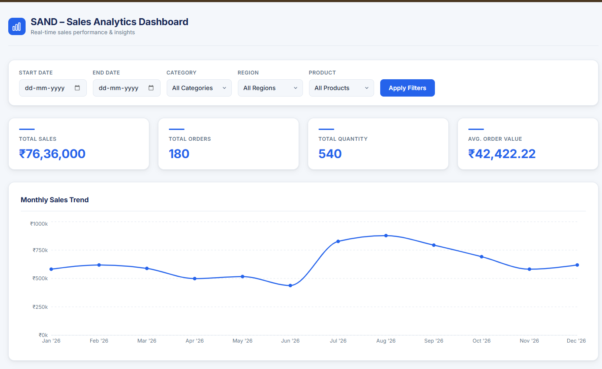
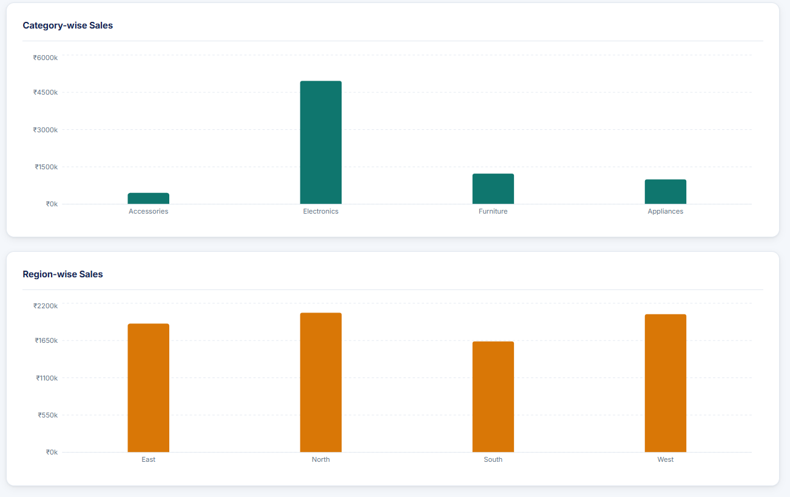
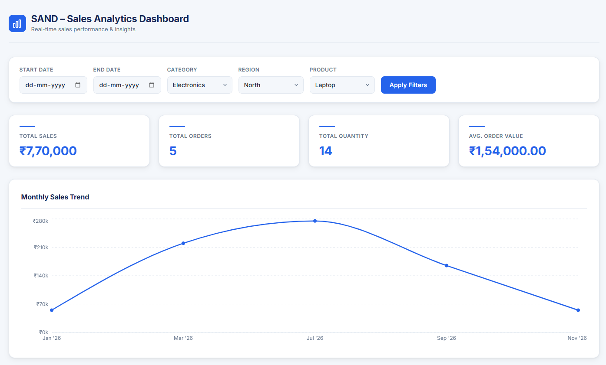
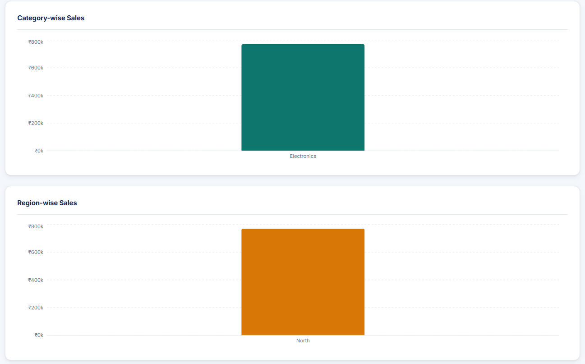

 <div align="center">

# 📊 SAND — Sales Analytics Dashboard

**A full-stack MERN application for interactive sales data analysis**

[](https://www.mongodb.com/)
[](https://expressjs.com/)
[](https://react.dev/)
[](https://nodejs.org/)
[](https://vitejs.dev/)
[](https://recharts.org/)

[](https://github.com/Kuldeeprajput08/SAND-Sales-Analytics-Dashboard/stargazers)
[](https://github.com/Kuldeeprajput08/SAND-Sales-Analytics-Dashboard/network/members)
[](https://github.com/Kuldeeprajput08/SAND-Sales-Analytics-Dashboard/issues)
[](https://opensource.org/licenses/MIT)

<br/>

> Dynamic filters · KPI cards · Interactive charts · MongoDB Aggregation · Real-time analytics

<br/>

</div>

---

## ✨ Features

| Feature                    | Description                                                    |
| -------------------------- | -------------------------------------------------------------- |
| 📦 **Sales KPIs**          | Total Sales, Total Orders, Total Quantity, Average Order Value |
| 📈 **Sales Trend**         | Monthly sales visualization with interactive line charts       |
| 🗂️ **Category Analysis**   | Sales grouped and compared by product category                 |
| 🌍 **Regional Analysis**   | Sales performance broken down by region                        |
| 🎛️ **Dynamic Filters**     | Filter by date range, category, region, and product            |
| ⚙️ **MongoDB Aggregation** | Backend pipelines for all analytics calculations               |
| 🛡️ **Error Handling**      | Invalid dates, API failures, loading states, empty results     |

---

## 🛠️ Technology Stack

<table>
<tr>
<td valign="top" width="50%">

### 🖥️ Frontend

- ⚛️ **React.js** — UI component library
- ⚡ **Vite** — Next-gen build tool
- 📡 **Axios** — HTTP client for API calls
- 📊 **Recharts** — Composable charting library
- 🎨 **CSS** — Custom styling

</td>
<td valign="top" width="50%">

### 🔧 Backend

- 🟢 **Node.js** — JavaScript runtime
- 🚂 **Express.js** — Web application framework
- 🍃 **MongoDB** — NoSQL database
- 🦫 **Mongoose** — MongoDB object modeling

</td>
</tr>
</table>

---

## 📁 Project Structure

```text
SAND/
├── backend/
│   ├── controllers/       # Route handler logic
│   ├── models/            # Mongoose schemas
│   ├── routes/            # API route definitions
│   ├── seed/              # Database seeder scripts
│   ├── .env.example       # Environment variable template
│   ├── package.json
│   └── server.js          # Express server entry point
│
├── frontend/
│   ├── src/
│   │   ├── hooks/         # Custom React hooks
│   │   ├── App.jsx        # Root application component
│   │   └── App.css        # Global styles
│   ├── services/          # API service functions
│   └── package.json
│
├── .gitignore
└── README.md
```

---

## 🚀 Getting Started

### ✅ Prerequisites

Make sure you have the following installed before proceeding:

| Tool                                                                                                   | Download                                                      |
| ------------------------------------------------------------------------------------------------------ | ------------------------------------------------------------- |
|  | [nodejs.org](https://nodejs.org/)                             |
|  | [mongodb.com](https://www.mongodb.com/try/download/community) |
|              | [git-scm.com](https://git-scm.com/)                           |

---

### 1️⃣ Clone the Repository

```bash
git clone https://github.com/Kuldeeprajput08/SAND-Sales-Analytics-Dashboard.git
cd SAND-Sales-Analytics-Dashboard
```

---

### 2️⃣ Backend Setup

```bash
cd backend
npm install
```

Create a `.env` file inside the `backend/` folder using `.env.example` as a template:

```env
PORT=5000
MONGO_URI=mongodb://127.0.0.1:27017/sand_db
```

---

### 3️⃣ Seed the Database

Populate MongoDB with sample sales records:

```bash
npm run seed
```

> 💡 This inserts realistic sample sales data into your local MongoDB instance.

---

### 4️⃣ Start the Backend Server

```bash
node server.js
```

The backend will be running at:

```text
http://localhost:5000
```

---

### 5️⃣ Frontend Setup

Open a **new terminal** and run:

```bash
cd SAND-Sales-Analytics-Dashboard/frontend
npm install
```

Create a `.env` file inside the `frontend/` folder:

```env
VITE_API_URL=http://localhost:5000/api
```

Start the development server:

```bash
npm run dev
```

Open the local URL shown by Vite — typically:

```text
http://localhost:5173
```

---

## 📡 API Documentation

**Base URL:** `http://localhost:5000/api`

### 🔗 Endpoints

| Method | Endpoint             | Description                    |
| ------ | -------------------- | ------------------------------ |
| `GET`  | `/sales`             | Fetch all sales records        |
| `GET`  | `/sales/summary`     | Get overall sales KPIs         |
| `GET`  | `/sales/by-category` | Get category-wise sales totals |
| `GET`  | `/sales/by-region`   | Get region-wise sales totals   |
| `GET`  | `/sales/trend`       | Get monthly sales trend        |

---

### 🎛️ Query Parameters (Filters)

All endpoints support the following optional query parameters:

| Parameter   | Type     | Description                                   |
| ----------- | -------- | --------------------------------------------- |
| `startDate` | `string` | Filter records from this date (`YYYY-MM-DD`)  |
| `endDate`   | `string` | Filter records up to this date (`YYYY-MM-DD`) |
| `category`  | `string` | Filter by product category                    |
| `region`    | `string` | Filter by region                              |
| `product`   | `string` | Filter by product name                        |

**Examples:**

```http
GET /api/sales/summary?startDate=2026-01-01&endDate=2026-06-30
GET /api/sales/by-category?region=North
GET /api/sales/trend?category=Electronics&startDate=2026-01-01
```

---

### 📦 Example API Response

**`GET /api/sales/summary`**

```json
{
  "success": true,
  "data": {
    "totalSales": 1420000,
    "totalQuantity": 120,
    "totalOrders": 30,
    "averageOrderValue": 47333.33
  }
}
```

> 📝 Actual values depend on your database records and applied filters.

---

## 🧮 MongoDB Aggregation

The backend leverages MongoDB **aggregation pipelines** to compute all dashboard metrics server-side, ensuring efficient and scalable analytics.

| Operator   | Usage                                        |
| ---------- | -------------------------------------------- |
| `$match`   | Filters records based on query parameters    |
| `$group`   | Groups records by category, region, or month |
| `$sum`     | Calculates sales totals and order counts     |
| `$avg`     | Calculates average order value               |
| `$sort`    | Orders results for trend charts              |
| `$project` | Selects and renames output fields            |

---

## 🛡️ Error Handling

The application gracefully handles:

- ❌ **Invalid date formats** — validates date input before querying
- 📡 **API request failures** — displays user-friendly error messages
- ⏳ **Loading states** — shows spinners while data is being fetched
- 🔍 **Empty results** — displays appropriate empty state UI for charts
- 🍃 **MongoDB connection errors** — logs and handles database connectivity issues

---

## 📸 Dashboard Screenshots

### 1. Dashboard Overview

The dashboard displays sales KPIs and monthly sales trends.





### 2. Dashboard with Combined Filters

The dashboard updates KPIs and charts based on the selected category, region, and product filters.





---

## 🏗️ Design Decisions

| Decision                                    | Rationale                                                          |
| ------------------------------------------- | ------------------------------------------------------------------ |
| Each sales document = one order             | Simplifies aggregation and counting logic                          |
| Total Orders = count of documents           | Straightforward mapping to business concept                        |
| Average Order Value = `$avg` on sales field | Reflects true per-order revenue average                            |
| Analytics calculated on backend             | Keeps frontend lightweight; leverages MongoDB's aggregation engine |
| Filters applied on button click             | Avoids excessive API calls during user input                       |
| Charts use API data only                    | No hardcoded values — fully data-driven visualizations             |

---

## 👨‍💻 Author

<div align="center">

**Developed as a MERN Stack Assessment Project**

⭐ **If you found this project helpful, please give it a star!** ⭐

</div>
